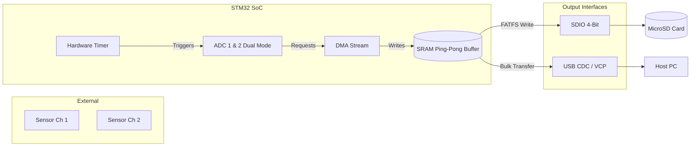

# STM32 High-Speed Data Acquisition (DAQ)

Sistem DAQ berbasis STM32 untuk kebutuhan sampling data frekuensi tinggi (misal: analisis getaran, load cell industri, atau sinyal akustik). Repo ini menggunakan pendekatan hardware-driven di mana ADC (Analog-to-Digital Converter) ditrigger oleh Timer, dan data dipindah langsung ke memori menggunakan DMA (Direct Memory Access) tanpa intervensi CPU.

## Diagram Arsitektur

## Fitur Utama
*   **Zero CPU Load Sampling**: CPU hanya bekerja memproses memori saat DMA memberikan interrupt (Half-Transfer & Full-Transfer).
*   **Ping-Pong Buffering**: Mencegah data loss saat proses penulisan ke SD Card atau pengiriman ke USB.
*   **Dual ADC Interleaved** (Opsional untuk F4/F7/H7): Memungkinkan sampling rate hingga satuan MSPS (Mega Samples Per Second).

## Struktur Direktori
*   `src/` - Source code (kompatibel dengan struktur STM32CubeIDE / Makefile standar).
*   `docs/` - Panduan wiring hardware dan penjelasan teknis DMA.
*   `scripts/` - Script Python untuk visualisasi data mentah di sisi PC.
*   `hardware/` - (Placeholder) Untuk file skematik atau layout PCB/Perfboard.

## Setup Awal
Pastikan sudah menginstall toolchain ARM GCC atau menggunakan STM32CubeIDE. Panduan lengkap terkait konfigurasi pin dan hardware ada di `docs/hardware_setup.md`.
