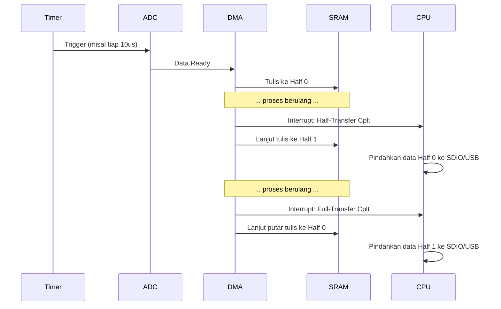

# Memahami Ping-Pong Buffer & DMA

Sistem berkecepatan tinggi tidak bisa menggunakan fungsi standard seperti `HAL_ADC_PollForConversion()`. Kita menggunakan DMA.

## Konsep Circular / Ping-Pong Buffer

Kita mengalokasikan satu array besar di RAM, dibagi menjadi dua paruh:
*   **Half 0** (Index 0 sampai N/2 - 1)
*   **Half 1** (Index N/2 sampai N - 1)

**Alur kerjanya:**
1.  DMA secara otomatis menulis hasil konversi ADC ke *Half 0*. CPU santai.
2.  Saat *Half 0* penuh, DMA men-trigger interrupt `HAL_ADC_ConvHalfCpltCallback`. DMA otomatis lanjut menulis ke *Half 1*.
3.  *Di dalam interrupt Half-Cplt*, CPU segera mem-parsing/menyalin/menyimpan data dari *Half 0* ke SD Card. Selama CPU sibuk menulis ke SD Card, data baru dari sensor tidak hilang karena DMA sedang menuliskannya ke *Half 1*.
4.  Saat *Half 1* penuh, interrupt `HAL_ADC_ConvCpltCallback` terpanggil. DMA berputar (*circular*) kembali menulis ke *Half 0*. CPU mengamankan data dari *Half 1*.

